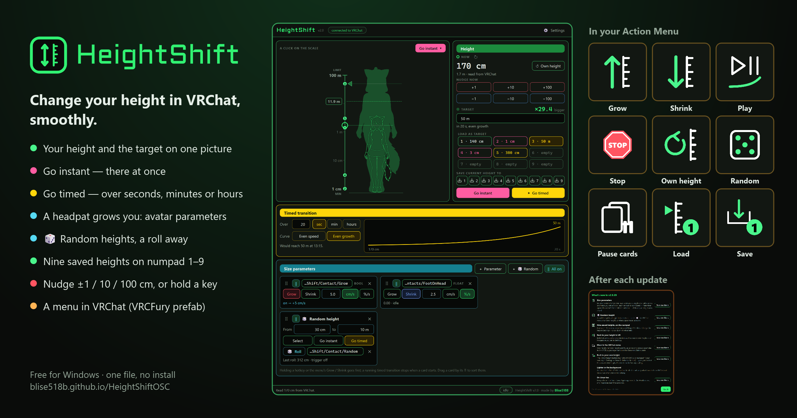

# HeightShift

A desktop app that sets your avatar's height in VRChat over OSC. Pick a target — drag it on the height
scale, type it, or load a saved height — then go there instantly or over a chosen time. Or nudge in
steps, hold a key, or use its own menu in VRChat.

**Website and download:** <https://blise518b.github.io/HeightShiftOSC/> ·
[HeightShift.exe](https://github.com/Blise518B/HeightShiftOSC/releases/latest/download/HeightShift.exe)



## Features

- **Reads before it writes.** On startup the app only *reads* your avatar's height from VRChat. Nothing
  is sent until you change it, and the ± buttons, profile saves and transitions all start from that real
  height (never from a made-up default).
- **Exact heights.** Heights are kept to the millimetre as VRChat reports them (1.29905 m stays 129.9 cm)
  — no rounding, no clamping of what was read.
- **Every write is checked.** A height outside the limits is refused with a message in the status bar,
  never quietly changed into a different one.
- **Your height and the target on one picture.** Two copies of the same figure stand on a height scale,
  one in front of the other: the target as a soft shadow behind, your current height as bright lines in
  front, each with her eyes at her height on the scale (VRChat's height is eye height; the height line
  stops at her head and only a faint dotted line crosses her face), with the ratio written out (×29.4).
  The scale is
  logarithmic — 1 cm and 1000 m are both easy to see and to pick, so the picture is not to scale — and
  its ends are a range you set (MIN and MAX, or LIMIT at the cap): click either number on the scale and
  type a new one (Enter keeps it, Esc doesn't; a range that can't be is refused with why, never clamped).
  The figures ease smoothly on every click, every transition step and while a key is held; what marks a
  height (the pointer, the ring, their lines and the height number) is there at once. In a narrow
  window the picture shrinks first; only when even the smaller one doesn't fit does the Height panel go
  under it.
- **Pick the target, then go.** Pick it on the scale — click or drag anywhere along it, drag the pointer,
  or pull either head up or down (a dashed line with the height follows the mouse first) — by typing it
  (`170`, `1.7 m`, `1,7 m`, `50 m`, `1.2 km`), or by loading one of nine saved heights as the target
  (click it in the panel, its numbered mark on the scale, or press numpad 1–9). Picking sends nothing by itself: **Go
  instant** sets the target at once; **Go timed** glides there over the time set below. The ring on the
  scale only shows where you are.
- **Or go with one click.** The button on top of the picture says what a click on the scale does:
  *Select height* (only pick, the default), *Go instant* (pink: go there at once) or *Go timed*
  (yellow: start the transition there); pressed, the other two unfold right there in the card. Each
  saved height has the same choice — with Settings open, the ▾ on its right edge; or right-click it —
  and wears its colour: a pink "1 cm" slot is one click from 1 cm.
- **Timed transition** — a duration in seconds, minutes or hours and a curve: *Even speed* (same cm every
  second) or *Even growth* (same percentage every second, so 1 m → 50 m doesn't rush at the start). A
  graph shows the curve with a playhead; Pause / Resume / Stop. Sends 30 updates a second by default
  (10 / 30 / 60 in Settings → Height; VRChat sets no limit).
- **Size parameters** — a card below the timed transition where avatar parameters grow or shrink you
  while they're on: a contact (a headpat, a foot on your head), a toggle, a radial. One card each, with
  its own direction, speed (cm/s or %/s) and ‖ / ▶, and one switch for all. A Bool works at the card's
  full speed, a Float (0–1) at that share of it, an Int while it isn't 0; several at once add up. A
  held key or menu button goes first; a running transition stops when a card starts. *+ Parameter*
  (or a card's name) opens the avatar's parameter list on the right of the window — filter, click one,
  or drag it onto a card; drag a card by its ⠿ to sort them. Only the parameters on cards are decoded.
- **🎲 Random height** — a card that picks a height between two (even on the height scale), on its 🎲,
  the VRChat menu's *Random height*, or when its parameter turns on; then selects it, goes there at
  once or starts the timed transition — as set on the card.
- **VRChat menu** — a VRCFury prefab adds a HeightShift submenu to your avatar's Action Menu: Grow and
  Shrink while held, Play / Pause and Stop for the timed transition, Own height, Random height, a
  Pause cards toggle, and saved heights 1–4 (set or save). The package also has contact examples
  (`HeightShift Contact Grow / Shrink / Random`) that drive the matching cards — drag one on, pick the
  body part. It talks only to this app and costs the avatar no synced parameter memory. See
  [`docs/VRCHAT_MENU.md`](docs/VRCHAT_MENU.md). The bottom of Settings is a mini guide to it: what each
  of its icons does, with links to the prefab (the newest release's) and the setup guide.
- **Hold-to-grow hotkeys** (on from the first start; switch them off in Settings) — hold a key to grow or
  shrink smoothly, for as long as you hold it. Speed in cm per second (5 cm/s to start) or % per second
  (feels the same at 30 cm and at 50 m). Pick
  your own keys (numpad + / − by default, with Ctrl / Shift / Alt if you like). By default they only work
  while VRChat is the window in front, so typing the key in Discord changes nothing. The keys are read,
  never intercepted: every other program still gets them. Windows only.
- **Saved-height keys** — numpad 1–9 do what a click on saved height 1–9 does (select, go instant or
  go timed); each key can be changed in Settings. A tap between two polls of the keyboard still counts.
- **Back to the avatar's own height** — the "↺ Own height · 1.43 m" button top right of NOW, the reset
  key (numpad `*` by default, your own in Settings), the VRChat menu's *Own height*, or in VR a gesture:
  both fists (grip + trigger) and a jump by default — the gesture on each hand, and *jump* or *hold
  1.5 s*, are set in Settings (read from VRChat's own gesture parameters: any controller, nothing on
  the avatar). One press puts you back at the height the avatar has before any scaling. VRChat reports it indirectly: its
  `ScaleFactor` parameter is the current eye height over the avatar's own, so own = current ÷
  ScaleFactor (read from VRChat when it hasn't been sent yet).
- **Unlock upper limit** — off: nothing above 100 m is ever sent. On: up to 1000 m, and the height
  scale's top goes up to 1000 m with it (off again: back to 100 m). VRChat or the world may still cap
  it lower.
- Nudge now: ±1, ±10, ±100 cm, sent at once (+N in a red frame over −N in a blue one); a step past a
  limit stops at it (−100 at 85 cm goes to 1 cm). Save current height to: stores your height in one of
  the six saved heights.
- **Keep my height when I switch avatars** — resends the height you had *before* the change for about
  two seconds, and once more if VRChat didn't take it. Any manual change cancels it.
- Automatic OSCQuery / mDNS discovery of VRChat, plus the OSC Router 518 fallback.
- The 518 look: Neon (default) and Midnight, text size control (Ctrl + wheel, Ctrl + / −, Ctrl + 0),
  settings always visible in a side panel, the window reopens where you left it.
- One instance at a time: starting it again brings the running window to the front.
- **Updates itself** (VRCParameterRelay's updater) — at every start it asks GitHub for the newest
  release; a newer one lights an orange chip in the header and opens a window: *Install now* downloads
  it, checks its size and SHA-256, swaps the exe and restarts (your heights and settings stay). *Later*
  is the default, so a stray Enter never installs; *Don't remind me* quiets that version. Settings →
  Updates checks by hand. A copy run from source can't replace itself and gets the release page.
- **What's new** — after an update, once: what changed, one page per release, with *Take me there* to
  where a change lives (it lights up). Never on a first install; Settings → Updates → *What's new*
  shows it again.
- The status bar's *HeightShift* opens its GitHub page, *Blise518B* his GitHub profile.

## Running

```bash
run.bat
```

`run.bat` creates / repairs a virtual environment, installs [`requirements.txt`](requirements.txt)
(PySide6, python-osc, zeroconf, requests) and starts `main.py`. Python 3.10+.

**Linux:** download `HeightShift-Linux-x86_64.AppImage` from the latest release, make it executable
(`chmod +x`) and run it — it updates itself like the exe. From source: `python3 -m venv venv &&
venv/bin/pip install -r requirements.txt && venv/bin/python main.py`. Everything works there except
the hold-to-grow hotkeys, which read Windows' key state (the VRChat menu's Grow / Shrink still do).

Build a standalone exe for yourself with `build.bat` (PyInstaller, one file, windowed); Linux:
`bash tools/build_linux.sh`.

**A release** is built on GitHub, never here: `release.bat` starts
[`.github/workflows/release.yml`](.github/workflows/release.yml) on `main`, which tests on Windows and
Linux, builds `HeightShift.exe` and `HeightShift-Linux-x86_64.AppImage` with the version
`2.0.<commits on main>` baked in, and only then publishes the release `v<version>` with both, the
VRChat menu package and the notes from CHANGELOG.md's `## [<version>]` section. A failed test or build
publishes nothing. The updater picks its platform's file from the newest release; the Settings guide's
"Get the VRCFury prefab" link is `releases/latest/download/HeightShift-VRCFury.unitypackage`.

## VRChat setup

Turn on OSC in VRChat (Action Menu → Options → OSC). That's all — HeightShift finds VRChat by itself.
Everything is loopback-only (`127.0.0.1`), so there is no IP to set and no firewall prompt.

## Settings

Stored as JSON, written atomically. A file that can't be read is kept next to it as
`*.corrupt-<time>.json` instead of being overwritten.

| OS | Config | Diagnostics log |
|----|--------|-----------------|
| Windows | `%APPDATA%\HeightShift\HeightShiftOSC_config.json` | `%APPDATA%\HeightShift\osc_diagnostics.log` |
| macOS | `~/Library/Application Support/HeightShift/…` | same folder |
| Linux | `~/.config/HeightShift/…` | same folder |

The folder was called `HeightShiftOSC` before; an old folder is adopted automatically.

Keys: `profiles` (`profile1`–`profile9`, cm) · `startup_mode` (`query` = read my height, `fixed_height`
= send `startup_height` once, the first time VRChat connects) · `startup_height` ·
`slider_min_value` / `slider_max_value` (the height scale's ends) · `preserve_height_on_avatar_switch` · `unlock_upper_limit` ·
`transition_target_cm` / `transition_duration` / `transition_unit` / `transition_curve` ·
`hotkeys_enabled` · `hotkey_grow` / `hotkey_shrink` / `hotkey_reset` (`{"vk": <Windows key code>, "mods": <1 Ctrl | 2 Shift
| 4 Alt>}`) · `hotkey_speed` / `hotkey_speed_unit` (`pct` / `cm`) · `hotkeys_vrchat_only` ·
`osc_router_518` · `hide_console` · `ui_mode` (`neon` / `midnight`) · `text_scale` · `settings_open` ·
`window_geometry_qt` · `skip_update_version` (the release tag set to "don't remind me") ·
`profile_actions` (`{"profile1": "select" | "instant" | "timed"}`) · `scale_mode` (the same three) ·
`whats_new_seen_version` (the newest notes shown) · `hotkey_slots` (nine keys, saved heights 1–9) ·
`size_params` (the cards, in order: `{"kind": "param", "param", "type", "dir": "grow" | "shrink",
"speed", "unit", "on"}` or `{"kind": "random", "param", "min", "max", "go", "on"}`) · `size_params_on` ·
`vr_reset_gesture` · `vr_reset_left` / `vr_reset_right` (VRChat's gesture numbers, 1 = fist) ·
`vr_reset_then` (`jump` / `hold`).

## OSC

| Address | Direction | Value |
|---------|-----------|-------|
| `/avatar/eyeheight` | send + receive | eye height in metres (cm ÷ 100) |
| `/avatar/change` | receive | avatar id — triggers "keep my height" |
| `/avatar/parameters/HeightShift/*` | receive | the VRChat menu: `Grow`, `Shrink`, `Play`, `Stop`, `Reset`, `Roll` (Bool, held while pressed), `Pause` (Bool toggle), `Load`, `Save` (Int 1–4); the contact examples' `Contact/Grow`, `Contact/Shrink`, `Contact/Random` — see [`docs/VRCHAT_MENU.md`](docs/VRCHAT_MENU.md) |
| `/avatar/parameters/<a card's parameter>` | receive | size parameter and 🎲 cards; `GestureLeft`, `GestureRight`, `Grounded` for the VR gesture. Only these are decoded; the picker reads the list from VRChat's OSCQuery tree (`/avatar/parameters`) once a second while it is open |

Whether the avatar has the menu is read from VRChat's OSCQuery tree (`/avatar/parameters/HeightShift`)
when VRChat connects and after every avatar change. A menu press that arrives within a second of an
avatar change, or within 0.15 s of the same button's release (the 518 router delivers every packet
twice), is not a press (`height_logic.MenuInput`).

## Development

```bash
python -m unittest discover -s tests
```

| Where | What |
|-------|------|
| `main.py` | entry point: config folder, single instance, theme, window, controller |
| `controller.py` | decides what is sent and when; the one write path (`_write`) and the one read path (`_on_reported`) |
| `height_logic.py` | the rules, without Qt or network: limits, which report to trust, the height to keep across an avatar change, the transition clock, the height while a key is held |
| `hotkeys.py` | which key is which, and whether it is held right now (polled, never hooked) and VRChat is in front |
| `osc/manager.py` | the connection to VRChat: mDNS discovery, handshake, receive / read / send, health check, watchdog |
| `osc/oscquery.py` | the OSCQuery documents we serve (`?HOST_INFO`, the tree) and reading VRChat's nodes |
| `osc/diag_log.py`, `osc/router518.py` | `osc_diagnostics.log`; the OSC Router 518 fallback |
| `ui/window.py` | the main window — a pure view: signals out, setters in |
| `ui/figure.py` | the size comparison on its height scale: NOW in front of TARGET, each with her eyes at her height on the log scale, eased (a critically damped spring in log space, so a stream of updates reads as one motion); picking the target on the scale (pointer, a click or drag along it, either head) and saved-height marks — it never sets a height; the stage shrinks for a narrow window (`set_fit`) |
| `ui/theme.py`, `ui/widgets.py`, `ui/graph.py` | the 518 look, small building blocks, the transition graph |
| `assets/` | the figure: OscGoesPurrr's Suits cat girl (`figure.png`, same author, MIT) and her silhouette (`figure_fill.png`, made by `tools/make_figure_assets.py`) |
| `docs/unity/`, `tools/make_menu_icons.py`, `tools/build_vrcf_prefab.py` | the VRChat menu: its VRCFury package, its icons, and how both are built (docs/VRCHAT_MENU.md) |
| `config_manager.py`, `console_window.py`, `single_instance.py` | settings file, the run.bat console, one instance |
| `whats_new.py`, `ui/whats_new.py` | What's new: the notes per release and the rule for when they show (pure data); its window. Add a release at the top of `RELEASES` |
| `updater.py`, `ui/update_dialog.py` | the self-update (VRCParameterRelay's): ask GitHub, verified download, the swap helper; the update window (a pure view) |
| `assets/menu/` | the VRChat menu's icons for Settings' mini guide (96 px copies, `tools/make_menu_icons.py --app-only`) |
| `release.bat`, `.github/workflows/release.yml`, `tools/build_linux.sh`, `tools/bake_version.py` | a release: started here, tested, built (exe + AppImage) and published on GitHub |
| `tools/make_preview.py` | draws `docs/preview.png` (this README's picture), `docs/site/og.png` (link previews) and `docs/site/app.png` from the app itself; re-run it when the window changes |
| `docs/index.html`, `docs/site/` | the website (GitHub Pages from `/docs` on `main`): the download, what it does, the VRChat menu; `site/tokens.css` is a verbatim copy of `_hub\design\tokens.css`, `site/app.png` the app's default window |

The OSC layer is transport only; whether a height VRChat reports can be trusted is decided in
`height_logic.ReportGate`. Every report carries the time it was *seen* (an OSC packet: when it arrived;
an HTTP read: when it was asked for), so a slow answer can never replace a newer height.

Tests: `test_height_logic.py` covers the rules directly, `test_controller.py` drives the real controller
with a fake OSC manager, `test_osc.py` runs the real sockets against a small fake of VRChat's OSCQuery
server (handshake, ping from the listener port, send, receive), `test_figure.py` checks the height scale
with real mouse drags (picking only the target, never a height; clicks along the scale, snapping,
saved heights, heads, the hover line, locked while a transition runs), the stage shrinking for a narrow
window, the ratio text, small figures and the easing, `test_updater.py` the self-update without a
network (versions, which asset is ours, the verified download, and the update window: Enter = Later,
"don't remind me", install -> swap -> close, a failed download changes nothing), and
`test_vrcf_prefab.py` checks the committed VRChat menu package against the app's parameter names.

## License

GNU GPL v3 — see `LICENSE`.
