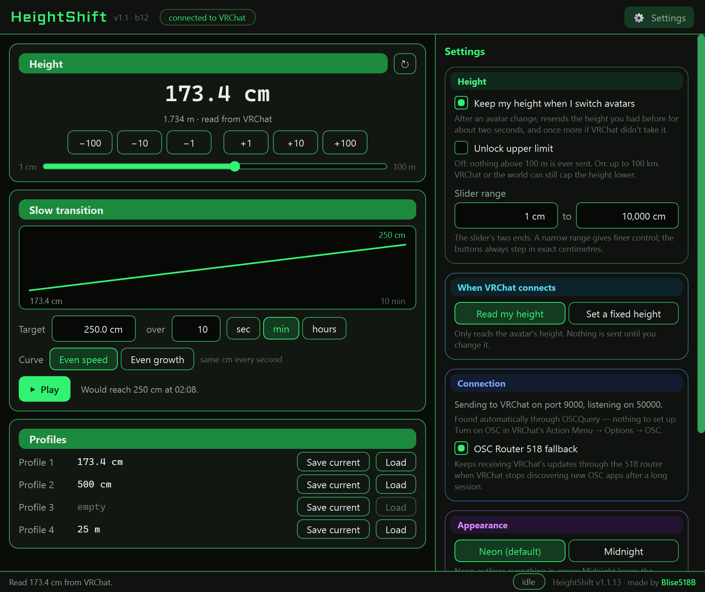

# HeightShift

A desktop app that sets your avatar's height in VRChat over OSC — instantly, in steps, from saved
profiles, or as a slow transition to a target height over a chosen time.



## Features

- **Reads before it writes.** On startup the app only *reads* your avatar's height from VRChat. Nothing
  is sent until you change it, and the ± buttons, profile saves and transitions all start from that real
  height (never from a made-up default).
- **Exact heights.** Heights are kept to the millimetre as VRChat reports them (1.29905 m stays 129.9 cm)
  — no rounding, no clamping of what was read.
- **Every write is checked.** A height outside the limits is refused with a message in the status bar,
  never quietly changed into a different one.
- **Slow transition** — pick a target height and a duration (seconds, minutes or hours), press Play, and
  the height glides there. A graph shows the curve with a playhead; Pause / Resume / Stop. Two curves:
  *Even speed* (same cm every second) and *Even growth* (same percentage every second, so 1 m → 50 m
  doesn't rush at the start). Sends at most 10 updates a second.
- **Unlock upper limit** — off: nothing above 100 m is ever sent. On: up to 100 km. VRChat or the world
  may still cap it lower.
- Quick steps (±1, ±10, ±100 cm), a logarithmic slider (1 cm and 100 m equally easy to hit) with a
  configurable range, and 4 profiles.
- **Keep my height when I switch avatars** — resends the height you had *before* the change for about
  two seconds, and once more if VRChat didn't take it. Any manual change cancels it.
- Automatic OSCQuery / mDNS discovery of VRChat, plus the OSC Router 518 fallback.
- The 518 look: Neon (default) and Midnight, text size control (Ctrl + wheel, Ctrl + / −, Ctrl + 0),
  settings always visible in a side panel, the window reopens where you left it.
- One instance at a time: starting it again brings the running window to the front.

## Running

```bash
run.bat
```

`run.bat` creates / repairs a virtual environment, installs [`requirements.txt`](requirements.txt)
(PySide6, python-osc, zeroconf, requests) and starts `main.py`. Python 3.10+.

Build a standalone exe with `build.bat` (PyInstaller, one file, windowed).

## VRChat setup

Turn on OSC in VRChat (Action Menu → Options → OSC). That's all — HeightShift finds VRChat by itself.
Everything is loopback-only (`127.0.0.1`), so there is no IP to set and no firewall prompt.

## Settings

Stored as JSON, written atomically. A file that can't be read is kept next to it as
`*.corrupt-<time>.json` instead of being overwritten.

| OS | Config | Diagnostics log |
|----|--------|-----------------|
| Windows | `%APPDATA%\HeightShift\HeightShiftOSC_config.json` | `%APPDATA%\HeightShift\osc_diagnostics.log` |
| macOS | `~/Library/Application Support/HeightShift/…` | same folder |
| Linux | `~/.config/HeightShift/…` | same folder |

The folder was called `HeightShiftOSC` before; an old folder is adopted automatically.

Keys: `profiles` (`profile1`–`profile4`, cm) · `startup_mode` (`query` = read my height, `fixed_height`
= send `startup_height` once, the first time VRChat connects) · `startup_height` ·
`slider_min_value` / `slider_max_value` · `preserve_height_on_avatar_switch` · `unlock_upper_limit` ·
`transition_target_cm` / `transition_duration` / `transition_unit` / `transition_curve` ·
`osc_router_518` · `hide_console` · `ui_mode` (`neon` / `midnight`) · `text_scale` · `settings_open` ·
`window_geometry_qt`.

## OSC

| Address | Direction | Value |
|---------|-----------|-------|
| `/avatar/eyeheight` | send + receive | eye height in metres (cm ÷ 100) |
| `/avatar/change` | receive | avatar id — triggers "keep my height" |

## Development

```bash
python -m unittest discover -s tests
```

| Where | What |
|-------|------|
| `main.py` | entry point: config folder, single instance, theme, window, controller |
| `controller.py` | decides what is sent and when; the one write path (`_write`) and the one read path (`_on_reported`) |
| `height_logic.py` | the rules, without Qt or network: limits, which report to trust, the height to keep across an avatar change, the transition clock |
| `osc/manager.py` | the connection to VRChat: mDNS discovery, handshake, receive / read / send, health check, watchdog |
| `osc/oscquery.py` | the OSCQuery documents we serve (`?HOST_INFO`, the tree) and reading VRChat's nodes |
| `osc/diag_log.py`, `osc/router518.py` | `osc_diagnostics.log`; the OSC Router 518 fallback |
| `ui/window.py` | the main window — a pure view: signals out, setters in |
| `ui/theme.py`, `ui/widgets.py`, `ui/graph.py` | the 518 look, small building blocks, the transition graph |
| `config_manager.py`, `console_window.py`, `single_instance.py` | settings file, the run.bat console, one instance |

The OSC layer is transport only; whether a height VRChat reports can be trusted is decided in
`height_logic.ReportGate`. Every report carries the time it was *seen* (an OSC packet: when it arrived;
an HTTP read: when it was asked for), so a slow answer can never replace a newer height.

Tests: `test_height_logic.py` covers the rules directly, `test_controller.py` drives the real controller
with a fake OSC manager, and `test_osc.py` runs the real sockets against a small fake of VRChat's OSCQuery
server (handshake, ping from the listener port, send, receive).

## License

GNU GPL v3 — see `LICENSE`.
